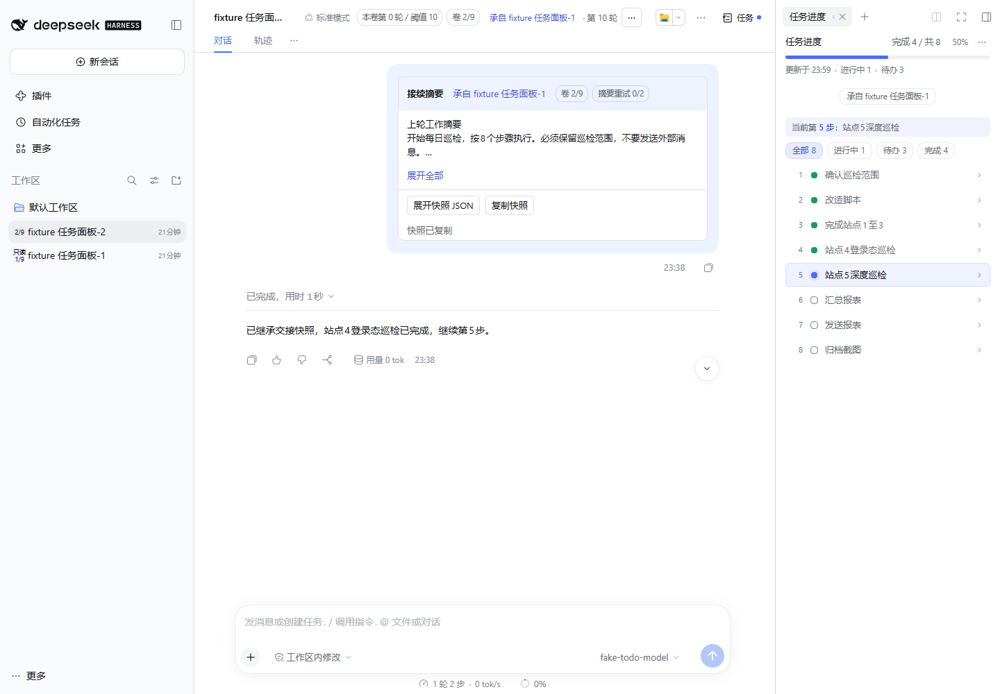
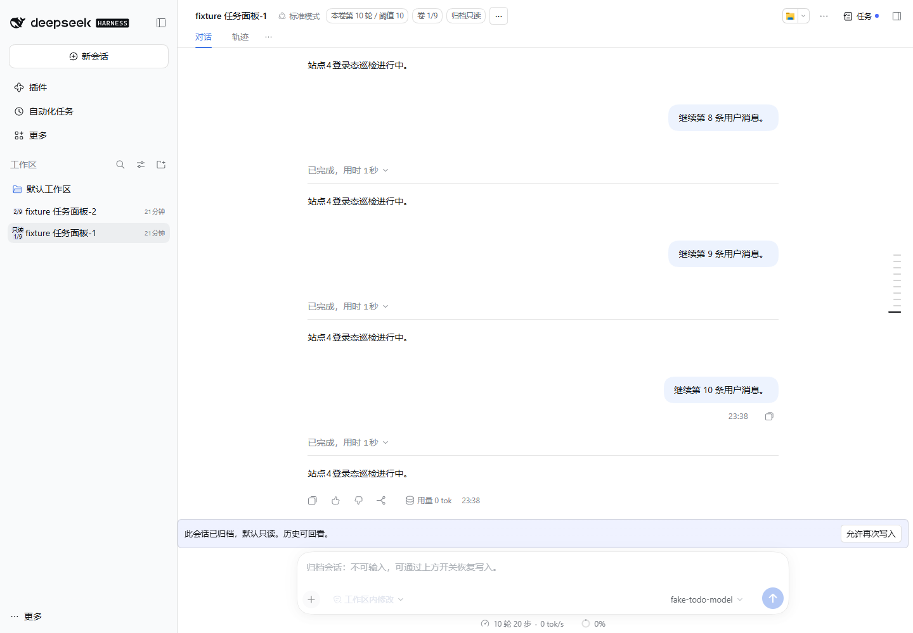
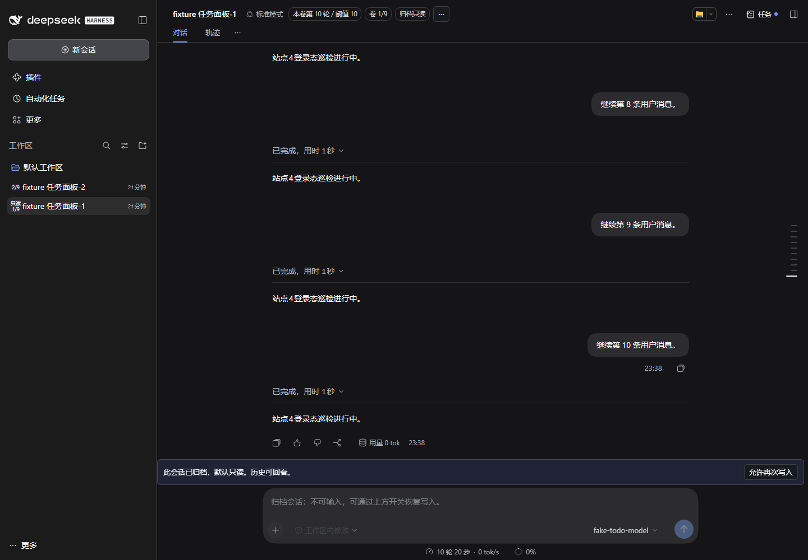

# dsh-session-rollover


**会话分卷与续接，让长任务跨会话继续。**

为 [DeepSeek Harness](https://github.com/deepseek-ai/dsh) 提供自动分卷、工作交接和历史回看。长会话达到设定轮数后，插件会在当前执行结束的安全时机创建下一卷，携带待办、当前步骤和约束继续工作，旧卷保留为只读归档。

适合持续编码、问题排查和多步骤任务。支持 Web 与桌面客户端，无需为插件单独配置 API Key。

**版本 1.2.0（待发布）** · **支持 DSH 0.2.1-rc.5 / 0.2.2-rc.1** · **维护者 Oak-liuhj**

[使用指南](./docs/DETAIL.zh-CN.md) · [English guide](./docs/DETAIL.md) · [更新记录](./CHANGELOG.md) · [问题反馈](https://github.com/Oak-liuhj/dsh-session-rollover/issues)

## 功能一览

| 功能 | 使用体验 |
| --- | --- |
| 自动分卷 | 默认每 10 条真实用户消息触发，等待当前执行及工具调用结束后交接 |
| 工作快照 | 新卷首条接续卡保留待办、全部进行中步骤、约束、文件线索和后台任务状态 |
| 摘要与 JSON | 摘要支持展开，完整快照可查看、复制，便于核对交接内容 |
| 来源回溯 | 标题栏显示轮数和卷序，接续卡可跳转上一卷 |
| 归档只读 | 旧卷默认只读，可切换“允许再次写入 / 恢复只读”，设置持久保存 |
| 手动接续 | 通过会话标题栏 `⋯` 提前换会话，或携带快照另开独立系列 |

每个会话系列最多 9 卷。达到上限后，可通过“新建独立会话”继续，并保留快照出处。

## 界面预览



截图来自隔离宿主与本地模型夹具。右侧实时任务进度由可选的 [dsh-todo-progress](https://github.com/Oak-liuhj/dsh-todo-progress) 提供；本插件的接续卡保留切卷时的历史快照，后续任务进度不会改写它。未安装任务进度插件时，也可使用分卷与交接功能。

<details>
<summary>查看归档只读与深色主题</summary>





</details>

## 安装

需要已配置模型、可正常对话的 DSH 宿主。浏览器入口随包预构建，安装插件时无需自行构建。

`1.2.0` 支持 DSH `0.2.1-rc.5` 和已完成实机验收的 `0.2.2-rc.1`。旧版 `1.1.1` 只声明支持前者，在新版宿主中会被阻止启用；请更新兼容版本，保留原数据目录。后续版本通过逐版检查和真实宿主验收适配；关键接口变化时暂停分卷并提示。维护机制与证据边界见 [DSH 升级适配](docs/COMPATIBILITY.md)。

可在 DSH 插件市场搜索 `dsh-session-rollover` 安装并启用，也可通过插件包名、GitHub 源或本地安装包安装。

### 通过 npm 包名安装

在桌面客户端的「插件 → 添加插件 → 填入插件 npm 包名」中填写：

```text
dsh-session-rollover
```

使用 CLI 时，以下命令以桌面 `desktop` profile 为例；Web 用户请替换为实际使用的 profile 名称：

```powershell
dsh plugin --profile desktop add dsh-session-rollover
```

此方式从 npm 下载发布包。国内镜像可能延迟同步；遇到 npm 404 时，先确认镜像已同步，或使用下方 GitHub 安装方式。

### 从 GitHub 安装

此方式获取 GitHub 仓库中已推送的代码：

```powershell
dsh plugin --profile desktop add github:Oak-liuhj/dsh-session-rollover
```

### 从本地安装包安装

将路径替换为实际 tgz 文件位置：

```powershell
dsh plugin --profile desktop add "D:/release/dsh-session-rollover-1.2.0.tgz"
```

桌面用户安装后，请通过桌面客户端重启宿主。已安装旧包 `@deepseek-ai/dsh-session-rollover` 时，应先替换旧依赖，避免同时加载新旧两份插件；升级前备份配置与插件数据。详细步骤见 [升级指南](./docs/PUBLISHING.md#从-scoped-旧包迁移)。

## 快速上手

1. **打开主会话**：标题栏会显示本卷轮数和阈值，默认阈值为 10 条真实用户消息。
2. **继续正常对话**：达到阈值后，等待当前执行结束。工具调用、压缩或换段尚未完成时，插件会暂缓分卷。
3. **查看新卷接续卡**：展开摘要、查看或复制 JSON，通过来源链接回看上一卷。
4. **按需手动操作**：点击标题栏 `⋯`，选择“现在换会话”“新建独立会话”或“使用说明”。

旧卷输入区域上方提供“允许再次写入 / 恢复只读”开关。恢复写入后可继续对话，但该旧卷不会再次自动分卷。

## 配置

正常安装已包含 [挂载补丁](./cordis.patch.yml)。在宿主中修改现有 `session-rollover` 插件节点的 `config`，无需重复添加节点。常用配置如下：

```yaml
mode: auto
threshold: 10
```

| 配置项 | 默认值 | 说明 |
| --- | --- | --- |
| `mode` | `auto` | `auto` 自动分卷；`manual` 达阈值只提示；`off` 关闭自动判定 |
| `threshold` | `10` | 每卷的真实用户消息阈值 |
| `forceAuto` | `false` | 保持自动模式，不因外部换段标记降为手动；仍执行安全检查 |
| `dataDir` | 自动 | 自定义本地持久化目录，例如 `D:/dsh-data/session-rollover` |

手动操作不受轮数阈值和 mode 限制，但仍需等待安全切点；只读、已封卷或子会话等状态也会限制操作。

## 常见问题

**“10 轮”按什么计算？**

每条真实用户消息计为一轮，与 token 数量或模型内部执行次数无关。系统上下文、技能目录和交接消息不计入；子会话不自动分卷。

**分卷会额外调用模型吗？**

摘要使用确定性摘录，不额外调用语言模型。新卷继续对话使用 DSH 已配置的模型；插件无需额外 API Key，正常对话仍遵循模型服务商的计费方式。

**为什么达到阈值后没有立即分卷？**

插件需要等待当前执行及工具调用结束，并避开压缩和换段。检测到外部 `[Checkpoint N]` 或 `[Handoff · part N]` 标记时，自动模式会降为手动；可检查配置与提示。宿主内部生成的交接上下文不会因此触发降级。

**后台任务也会自动恢复吗？**

快照记录后台任务的句柄和状态，不迁移、恢复或重新启动进程。文件路径仅作为交接线索，不代表文件一定已修改。

**交接内容过长或保存失败时会怎样？**

正文摘要上限为 1500 字符，完整交接消息上限为 16 KiB；超预算会拒绝交接并提示。自动交接初次失败后最多再试两次，由后续用户消息触发。出现存储降级提示时，应检查数据目录权限；文件存储不提供跨系统事务保证。

## 数据与卸载

数据保存在本机。默认目录为 `<DSH_HOME>/plugin-data/dsh-session-rollover`；未设置 `DSH_HOME` 时，使用 `~/.dsh/plugin-data/dsh-session-rollover`。可通过 `dataDir` 指定其他目录，更多路径优先级及文件说明见 [开发文档](./docs/DEVELOPMENT.md#数据目录)。

卸载命令：

```powershell
dsh plugin --profile desktop remove dsh-session-rollover
```

卸载保留插件数据，重新安装可继续读取。交接 JSON 可能包含会话约束和本地文件路径，分享前请检查内容。

## 兼容性与开发

历史基线 DSH `0.2.1-rc.5` 的验证覆盖自动分卷、待办续接、来源导航、双向只读开关及浅深主题；`1.2.0` 对 DSH `0.2.2-rc.1` 的实机验收记录见[升级适配指南](docs/COMPATIBILITY.md)。旧宿主可能不显示插件长说明，可从会话 `⋯ → 使用说明` 查看内置指南。

现有验证使用隔离宿主与本地模型夹具，完整 Bot 群端、生产模型和后续宿主版本仍需单独复验。详见 [功能验证](./docs/r3-validation.md) 与 [市场展示验证](./docs/marketplace-validation.md)。

[开发与集成](./docs/DEVELOPMENT.md) · [架构说明](./docs/architecture.md) · [发布与上架指南](./docs/PUBLISHING.md)

反馈问题时，请提供插件版本、DSH 版本、复现步骤和相关报错。维护者：Oak-liuhj。社区插件，与 DeepSeek 官方无隶属关系。

## 许可证

[Apache-2.0](./LICENSE) 与 [MIT](./LICENSE.upstream)。分发时须保留两份许可证及 [NOTICE](./NOTICE)。SPDX：`(Apache-2.0 AND MIT)`。
