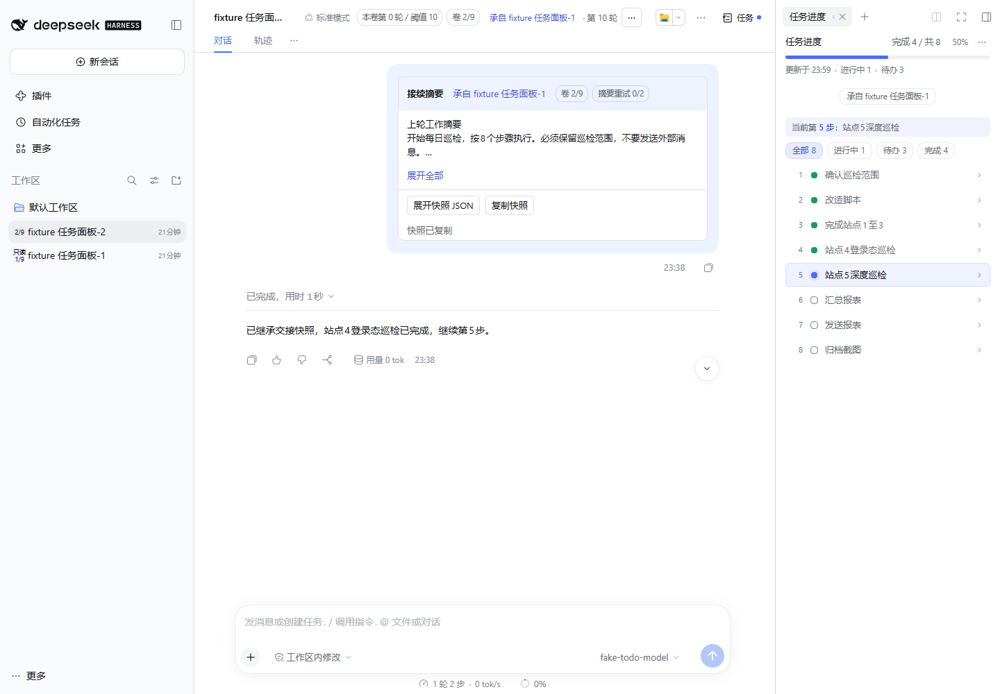

# Session Rollover

Split long DeepSeek Harness conversations into volumes and continue with a snapshot of the current work. Supports DSH Web and desktop.

## Features

- Counts actual user messages and creates the next volume after the current turn finishes safely. Default threshold: 10 messages. System context and handoff messages do not count.
- Adds a first-message handoff card with todos, all active steps, constraints, file references and unfinished job states. Expand the summary, inspect or copy the full JSON, and navigate to the source volume.
- Displays message count, threshold, volume number and archive state. Each series supports up to 9 volumes; start an independent series with a snapshot to continue beyond that limit.
- Archives previous volumes as read-only. The input-area switch can allow writing again or restore read-only mode, and persists across reloads and restarts.
- Provides **Roll over now**, **New independent conversation** and **Usage guide** in the conversation header's `⋯` menu. Current action labels and the built-in guide are in Chinese.

## Getting started

Install and enable `dsh-session-rollover` through the DSH plugin manager or marketplace. Desktop users must select the actual desktop profile and restart the host through the desktop app. Open a main conversation and continue working; rollover waits for a safe point after the threshold is reached. Use the source link to inspect the previous volume.

The optional `dsh-todo-progress` plugin shows live task progress. The handoff card remains a historical snapshot. R3 does not require R2 to split conversations.

## Configuration

| Setting | Default | Meaning |
| --- | --- | --- |
| `mode` | `auto` | `auto`: automatic rollover; `manual`: threshold notice only; `off`: no automatic evaluation |
| `threshold` | `10` | Number of actual user messages |
| `forceAuto` | `false` | Prevent external part markers from switching auto to manual; safety checks still apply |
| `dataDir` | Automatic | Custom local data directory |

Explicit manual actions bypass the mode and count threshold, but still require a safe session state. Subsessions do not roll over automatically. Restoring write access to an archived volume does not restart automatic rollover for that volume.

## Data and limits

Default storage: `<DSH_HOME>/plugin-data/dsh-session-rollover`, or `~/.dsh/plugin-data/dsh-session-rollover` without DSH_HOME. Uninstalling preserves data. Renaming the public package does not change storage or service interfaces. Snapshots may contain conversation constraints and local paths; review them before sharing.

Summaries use deterministic extraction, without another model call or API key. Conversation continuation uses the model configured in DSH. Background jobs are recorded as handles and states; processes are not moved, resumed or restarted. Summary text is limited to 1500 characters and the full handoff message to 16 KiB; oversized handoffs fail with a notice. Automatic failures get at most two further retries, triggered by subsequent user messages.

Version `1.2.1` declares the DSH installation range `0.2.1-rc.5 || >=0.2.2-rc.1 <0.3.0-0`. It includes `0.2.2-rc.3` and subsequent versions within the range, and excludes all `0.3.0` prereleases and stable releases. Historical runtime validation covers `0.2.1-rc.5` and `0.2.2-rc.1`; the latter used an isolated host and local model fixture for ten-message rollover, model and workspace inheritance, todo continuation, archive controls and restart recovery. The declared range and tested versions are maintained separately; the range does not claim runtime validation for every host, production model or Bot group channel. Retain the data directory when upgrading. Older hosts may omit this long description; the conversation `⋯` menu includes a built-in usage guide.

Replace the old `@deepseek-ai/dsh-session-rollover` dependency and bundle rather than loading both versions. Back up profile configuration and plugin data before upgrading. See the Chinese [publishing and migration guide](./PUBLISHING.md).

[Source](https://github.com/Oak-liuhj/dsh-session-rollover) · [Issues](https://github.com/Oak-liuhj/dsh-session-rollover/issues)

Maintained by Oak-liuhj. Distributed with Apache-2.0 and MIT notices. This is a community plugin, not an official DeepSeek product.
