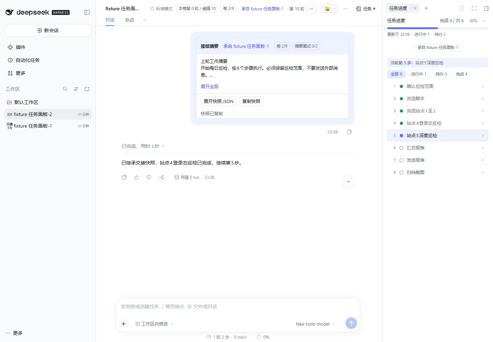

# 会话分卷与续接

让长会话在合适的时机切换到新卷，并携带待办、当前步骤和约束继续工作。适用于 DeepSeek Harness Web 与桌面客户端。

## 可以做什么

- **自动分卷**：默认累计 10 条真实用户消息后，在本轮执行结束、工具调用完成且未压缩时创建下一卷。系统上下文与交接消息不计数。
- **交接快照**：新卷首条消息包含摘要与完整 JSON，记录待办、全部进行中步骤、约束、文件线索和未完成后台任务状态。
- **来源回溯**：标题栏显示轮数、阈值及卷序，接续卡可跳转上一卷。每个系列最多 9 卷，之后可新建独立会话继续。
- **归档保护**：旧卷默认只读，支持“允许再次写入 / 恢复只读”；设置在刷新和重启后保留。
- **手动控制**：会话标题栏 `⋯` 可提前换会话、携带快照新建独立会话、查看使用说明。

## 快速使用

1. 在 DSH 插件管理器或市场安装并启用 `dsh-session-rollover`；桌面用户确认选择实际的 desktop profile，并通过桌面客户端重启宿主。
2. 打开一个主会话，标题栏会显示本卷轮数。正常对话，达到阈值后等待当前执行结束。
3. 新卷首条接续卡可以展开摘要、查看或复制原始快照 JSON，并通过来源链接回看旧卷。
4. 如需继续在旧卷对话，在归档提示中点击“允许再次写入”。恢复写入不会让该旧卷再次自动分卷。

若安装了可选的 `dsh-todo-progress`，右侧面板显示实时待办进度；交接卡保留切卷时的历史快照。R3 不另建任务状态，也不要求安装 R2 才能分卷。

## 配置

| 字段 | 默认值 | 含义 |
| --- | --- | --- |
| `mode` | `auto` | `auto` 自动分卷，`manual` 达阈值只提示，`off` 关闭自动判定 |
| `threshold` | `10` | 真实用户消息阈值 |
| `forceAuto` | `false` | 不因外部换段标记而降为 manual；仍执行安全检查 |
| `dataDir` | 自动 | 自定义本地持久化目录 |

显式手动操作不受 mode 和轮数限制，但仍需要当前会话处于安全状态；子会话不自动分卷。相同系列达到 9 卷时，使用 `⋯ → 新建独立会话` 另开系列，保留快照出处。

## 数据与边界

数据保存在本机，默认目录为 `<DSH_HOME>/plugin-data/dsh-session-rollover`（未配置 DSH_HOME 时为 `~/.dsh/plugin-data/dsh-session-rollover`）。卸载保留历史数据，公开包名更换也不改变该目录。交接快照与 JSON 可能包含会话约束和文件路径，分享前请检查内容。

摘要是确定性摘录，不调用额外模型；继续对话仍使用 DSH 已配置的模型，无需额外 API Key。后台任务只继承句柄和状态，不迁移、恢复或重新启动进程。正文摘要上限 1500 字符、完整交接消息上限 16 KiB，超预算会拒绝交接并提示。自动失败最多再试两次，由后续用户轮次触发。

兼容声明基于 DSH `0.2.1-rc.5`。本地模型夹具已验证十轮分卷和工具待办续接；不代表所有模型、Bot 群端或后续宿主版本均已验收。旧宿主可能不显示本长说明，可从会话 `⋯ → 使用说明` 查看内置指南。

## 升级与支持

旧 `@deepseek-ai/dsh-session-rollover` 用户须替换依赖和 bundle，避免同时加载新旧包；升级前备份配置与插件数据。详见 [发布与升级指南](./PUBLISHING.md)。

[源码](https://github.com/Oak-liuhj/dsh-session-rollover) · [反馈问题](https://github.com/Oak-liuhj/dsh-session-rollover/issues)

维护者 Oak-liuhj；保留 Fei2411 上游 MIT 贡献。本项目分发包含 Apache-2.0 与 MIT 两份许可证。社区插件，与 DeepSeek 官方无隶属关系。
