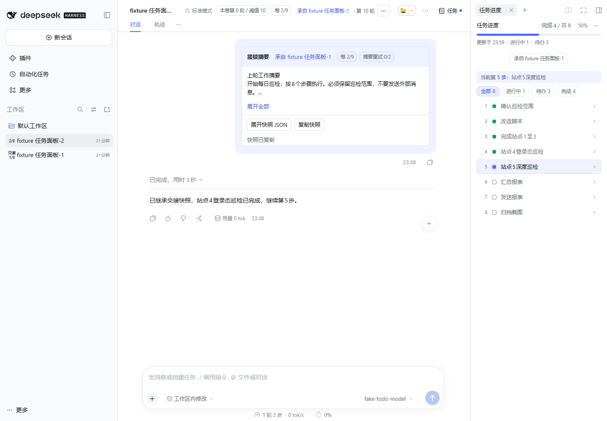
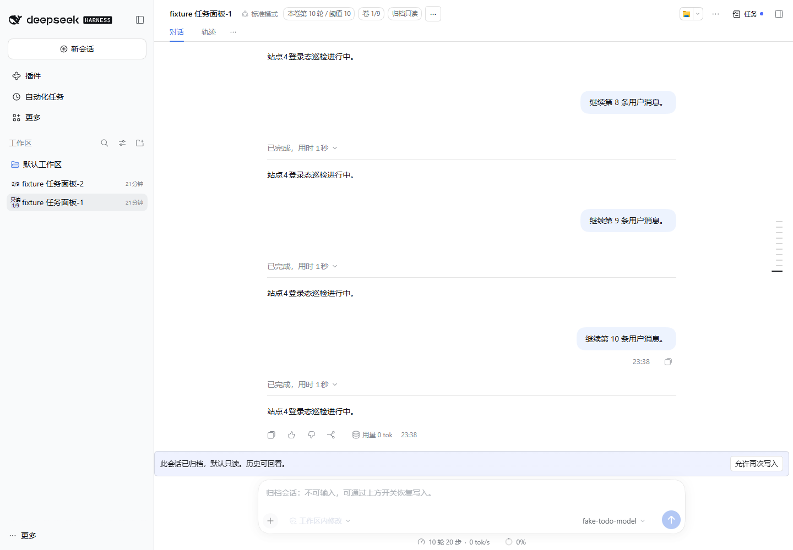
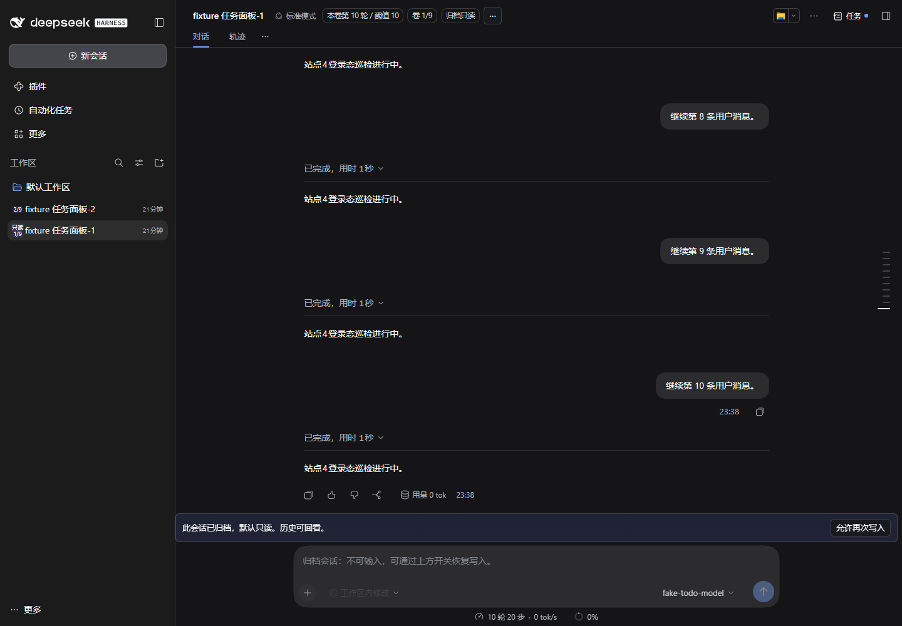

# R3 修复与验证记录

本轮按“先修分卷数据与状态一致性 → 补齐界面 → 调整样式”完成 1.1.0，基于原 c43b01d 的需求/页面分析落实。工作于 2026-11-06 开始，跨日完成验证。

## 已修复的问题

| 领域 | 修复后的行为 | 证据 |
| --- | --- | --- |
| 轮次/时机 | 按真实用户消息计数，排除宿主内部上下文；第十条消息回合结束后仅分一次 | 服务端回归、真实宿主日志与 UI |
| marker/换段 | system Handoff 和内部上下文不误降 manual；forceAuto 仍等待压缩结束 | 来源/压缩互斥回归 |
| 快照 | todos/jobs 同刻捕获，人读与 JSON 一致；多 active、原文约束、文件线索保留 | 接线回归、真实首条卡片/剪贴板逐字段比较 |
| 预算/失败 | 1500 字符及完整首条消息 16 KiB 硬闸；初次+两次重试持久化；建卷前存储预检 | 超限、重启、目录碰撞回归 |
| 卷序/命名 | 真卷序与重名后缀分离；用户标题保留；超 9 名称后缀不嵌套；第九卷可转独立新簇 | 命名与上限回归 |
| 恢复 | 索引丢失/损坏/合法但缺项均可补齐；废弃卷不参与重建；显式恢复写入不被覆盖 | 多种重启夹具 |
| 提交后异常 | 辅助状态写盘异常不会把成功翻成失败后再次创建；degraded 可见 | 异常注入回归 |
| 模型 | 继承失败通过公开默认模型服务回落并提示 | 接线夹具；真实宿主正常继承 |
| UI | 标题状态、列表徽标、会话操作、首条摘要、JSON 展开/复制、来源导航、归档开关 | 真实宿主浏览器 |
| 输入保护 | 公开 conversation.blocks 禁用输入；允许写入/恢复只读双向生效、刷新持久化 | 浏览器 contenteditable/ARIA 检查、阻塞释放回归 |
| 样式 | 摘要三行预览/展开、长文本、原生 dialog、防裁切、深色主题、旧宿主窄徽标 | 浏览器与截图复核 |
| 文档/入口 | README/架构说明更新；生成式 client；保留根入口与旧子路径 | 构建检查、包导出测试与实际打包导入 |

旧版只覆盖提示的前端已扩展为独立 `src/client/`；保持根 client.js 的宿主加载方式。未改宿主核心，也未修改相邻 R2 仓库源码。

## 自动化验证

- Node.js 24.22.1 内置测试：**86/86 通过**；旧基线 67 项基础上增加 19 项回归。support 模块不计入测试数。
- `npm run build:check` 检查生成入口与源文件一致。
- 实际 `npm pack` 后解压，**28 个入口/源码模块导入通过**，必需发布文件齐全，清单不含运行 profile、认证信息或测试产物。
- 原型浏览器：**14 项检查通过**，包含多入口回溯、双向只读/刷新、摘要/JSON 展开和复制、展开后滚动、快照不随任务续跑变化、37% 进度一致及重置。

机器结果：[真实宿主](./live-host-validation.json)、[原型](./prototype-validation.json)。打包与单元测试应在发布前再次使用上方命令复验。

## 真实宿主验证范围

使用本机已安装的 DeepSeek Harness，以独立 `DSH_HOME` 和 `r3-review` Web profile 启动，旁挂 R2/R3；模型请求接入本地 OpenAI 兼容夹具，不使用生产密钥。

实际过程发送十条用户消息，其中宿主还产生多条 `runtime-context` / `skill-catalog` / `time-context` user/message；统计结果仍为旧卷 10、新卷 0，只产生一个接续卷。新卷首条交接含 8 项待办、当前第 4 步，夹具通过真实 `todo_write` 完成第 4 步并启动第 5 步，右侧 R2 更新到 4/8、50%；历史 JSON 保持第 4 步时的原始快照。

后续在同一对已生成会话上继续浏览器复验，并重启宿主复验恢复：卡片/剪贴板与后端逐字段一致、来源跳转留在旧卷、readonly/可写双向设置跨刷新、contenteditable 真正禁用、旧宿主 leading 徽标回退，以及通过系统色彩偏好触发的宿主真实深色主题。最终浏览器记录无页面/控制台错误和失败资源请求。

中途测试暴露并修复了两个夹具没有覆盖的宿主差异：内部 user/message 来源不能当人类发言；输入组件子槽不能被普通包装/重复声明。因此最终改用公开 `conversation.blocks`，并为释放与其他阻塞原因共存增加测试。

## 原型同步

仓库 [r3-demo.html](./r3-demo.html) 修复原 R3 页面的演示状态：统一旧卷 ID、多入口共享状态、双向只读持久化、真实摘要/JSON 展开、全部继承任务来源标识、任务续跑不篡改历史、清除状态后重置。3/8 进度与当前 R2 `Math.floor` 口径统一为 37%。旧八段注入默认关闭，仅作为兼容示意。

用户原路径的 HTML 已同步为验证版，覆盖前比对原始哈希并保留同目录 `v0.1.before-r3-fix.html` 备份。原型仍是固定数据、单次分卷演示，不作为真实模型运行证据。

## 验收边界

本轮已完成代码修复、隔离宿主 Web 与固定模型工具接续验证；未据此重新宣称全部历史 AC 或 Bot 群端验收通过。生产模型输出质量、真实后台进程跨卷运行及 Bot 群消息端仍需在对应目标环境验收；后台任务当前仅传句柄/状态，不迁移进程。

宿主会话和多个 JSON 文件不是原子数据库事务；存储异常已预检、补偿、恢复并暴露降级，但不能保证断电/多文件同时损坏时零损失。索引恢复依赖宿主仍保留交接消息和有效来源。测试进程已使用独立 profile，用户默认 profile/凭据未参与修改。
